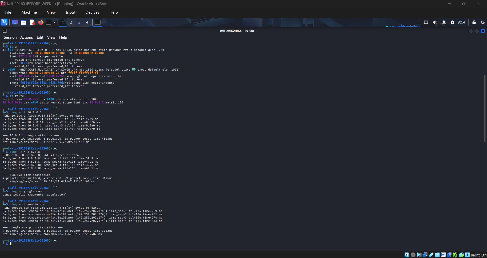
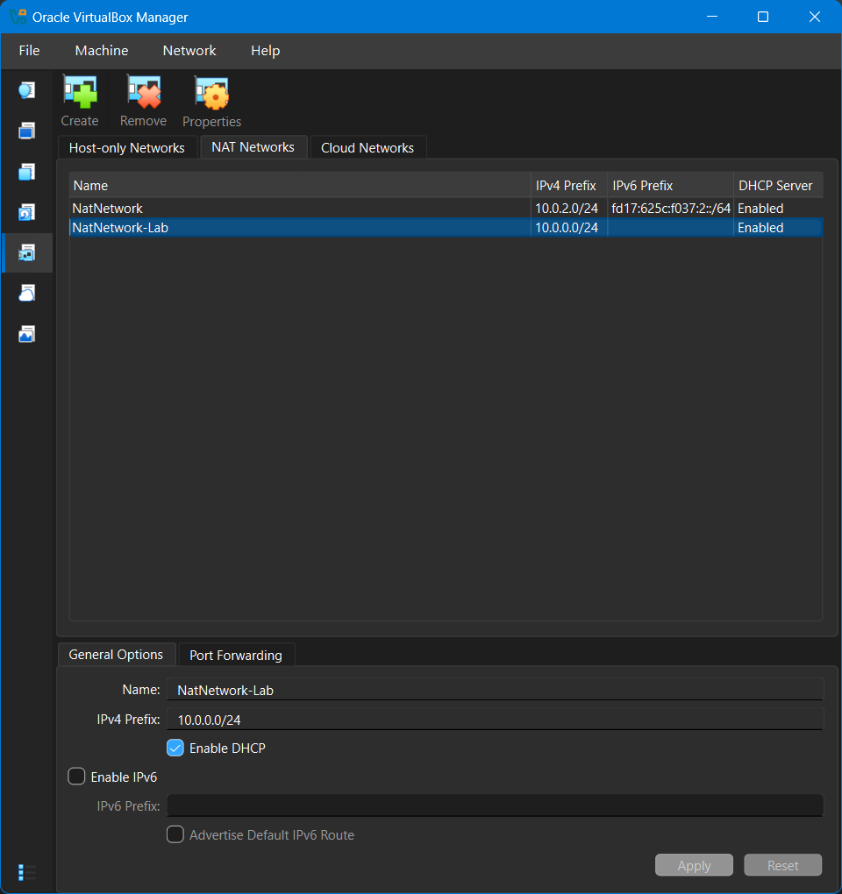
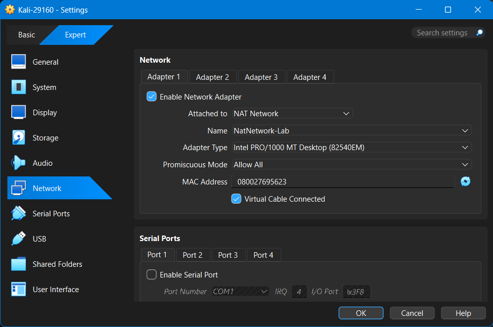
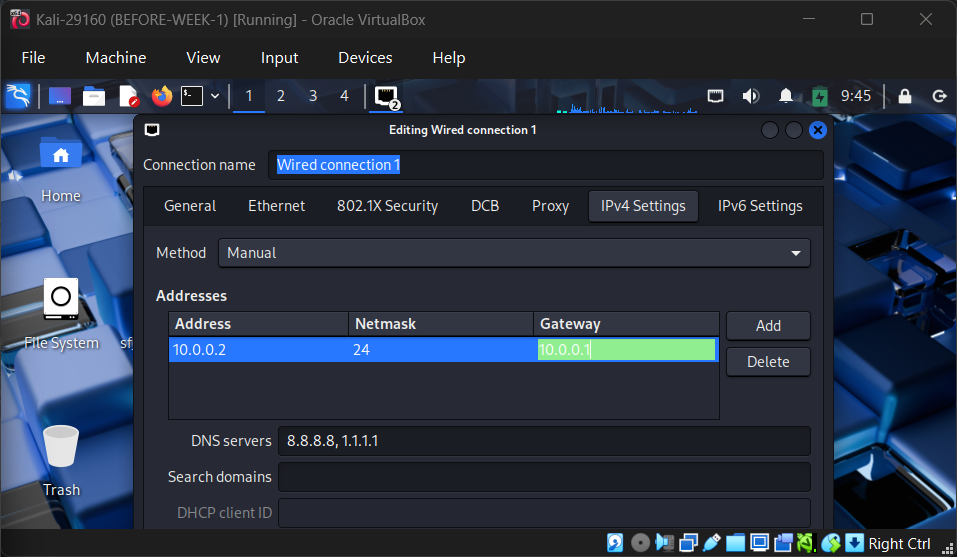

# 🔐 Cybersecurity Lab Environment Setup

**Building an isolated virtual lab for penetration testing and ethical hacking practice**

---

## 📌 Project Overview

This project sets up a **virtual cybersecurity lab** on my own computer using VirtualBox and Kali Linux.

The lab gives me a controlled place to practise scanning, reconnaissance and other security testing safely and repeatedly. It runs on a private virtual network, so more machines can be added later and used as targets for authorized testing.

⚠️ **Important:** This lab is for education only. It runs entirely on my own computer, and I only test systems I own or have written permission to test.

---

## 🎯 Objectives

- Install VirtualBox as the base for the lab
- Create a private NAT Network on `10.0.0.0/24`
- Attach a Kali Linux VM to it with the static IP `10.0.0.2/24`
- Enable clipboard, drag-and-drop and a shared folder
- Confirm full Internet access from Kali
- Take snapshots so the VM can be restored if something breaks

---

## 🏗️ Lab Architecture

```
Host PC (Windows)
 └── VirtualBox 7.2.22
      └── NAT Network: NatNetwork-Lab (10.0.0.0/24, DHCP enabled)
           └── Kali Linux VM (Kali-29160): 10.0.0.2/24
```

Kali running on the lab network, with the connectivity test:



---

## ⚙️ Lab Configuration

| Component | Configuration |
|---|---|
| Host OS | Windows |
| Hypervisor | VirtualBox 7.2.22 |
| Security OS | Kali Linux (VM `Kali-29160`) |
| Kali RAM / CPUs | 2048 MB / 2 |
| Virtual Network | NAT Network `NatNetwork-Lab` |
| Network Address | 10.0.0.0/24 |
| Kali IP Address | 10.0.0.2/24 |
| Default Gateway | 10.0.0.1 |
| DNS Servers | 8.8.8.8, 1.1.1.1 |
| Clipboard / Drag-and-Drop | Bidirectional |
| Shared Folder | Host Downloads folder (auto-mounted in Kali) |

---

## 🪜 Lab Setup Procedure

### Step 1. Install VirtualBox
I installed the latest VirtualBox (version 7.2.22) from the official site and used my existing Kali Linux VM, `Kali-29160`.

### Step 2. Take a snapshot before making changes
Before touching any settings I took a snapshot named `BEFORE-WEEK-1`, so I could roll back if a network change broke the VM.

### Step 3. Create the NAT Network
In **File > Tools > Network > NAT Networks** I created a new network:

- Name: `NatNetwork-Lab`
- IPv4 Prefix: `10.0.0.0/24`
- DHCP: enabled
- IPv6: disabled

A default `NatNetwork` (10.0.2.0/24) already existed on my machine, so I created a separate network instead of changing it. This protects my other VMs.



### Step 4. Configure the Kali VM
In the Kali VM settings:

- **Network, Adapter 1:** attached to NAT Network `NatNetwork-Lab`, adapter type Intel PRO/1000 MT Desktop, Promiscuous Mode set to Allow All
- **Adapters 2 and 3** (host-only and bridged): disabled, so Kali only sits on the lab network
- **General > Features:** Shared Clipboard and Drag-and-Drop both set to Bidirectional
- **Shared Folders:** host Downloads folder added with Auto-mount



### Step 5. Set the static IP in Kali
In Network Connections > Wired connection 1 > IPv4 Settings:

```
Method:  Manual
Address: 10.0.0.2
Netmask: 24
Gateway: 10.0.0.1
DNS:     8.8.8.8, 1.1.1.1
```

I also applied the fix recommended for VirtualBox 7 with newer Kali versions:

```bash
sudo nmcli connection modify "Wired connection 1" ipv4.dad-timeout 0
sudo nmcli connection down "Wired connection 1"
sudo nmcli connection up "Wired connection 1"
```



### Step 6. Take the final snapshot
After testing everything I took a snapshot named `WEEK1-LAB-COMPLETED`. The Snapshots tab now shows `BEFORE-WEEK-1` and `WEEK1-LAB-COMPLETED`.

---

## 🔎 Lab Verification

| Test | Command | Result |
|---|---|---|
| Check IP address | `ip a` | `eth0` is UP with 10.0.0.2/24, the only interface besides loopback |
| Check routing | `ip route` | Default route via 10.0.0.1 |
| Test gateway | `ping -c 4 10.0.0.1` | 4/4 replies, 0% loss |
| Test Internet | `ping -c 4 8.8.8.8` | 4/4 replies, 0% loss |
| Test DNS | `ping -c 4 google.com` | 4/4 replies, 0% loss |
| Shared folder | `ls /media/sf_Downloads` | Host Downloads files are listed |
| Clipboard and drag-and-drop | Copy/paste and drag a file from Windows | Works both ways |

---

## 🐞 Problems Encountered & Solutions

### Problem 1. A NAT network with the wrong subnet already existed
A NAT Network named `NatNetwork` with prefix `10.0.2.0/24` was already on my machine, but this lab needs `10.0.0.0/24`.

**Solution:** I did not edit it, because my other VMs might use it. I created a second network, `NatNetwork-Lab`, with prefix `10.0.0.0/24` and attached Kali to it.

### Problem 2. Extra network adapters on the Kali VM
The Kali VM had three adapters (NAT, host-only and bridged). The bridged one would put the attack machine on my real Wi-Fi, and extra adapters can interfere with the static IP and routing.

**Solution:** I moved Adapter 1 to the NAT Network and disabled Adapters 2 and 3. `ip a` then showed a single interface, `eth0`, with `10.0.0.2/24`.

---

## 💡 What I Learned

- How a VirtualBox NAT Network differs from plain NAT, and why it suits a multi-machine lab
- How to set a static IP, gateway and DNS in Kali with NetworkManager
- How to test connectivity step by step with `ip` and `ping`
- Why a snapshot before risky changes is a safe recovery point
- Why a lab should be isolated from my real network

---

## 🔐 Security & Ethical Use

This lab is for education only. Hacking is only legal on systems I own, in my own lab, or where I have written permission from the owner.

---

## 🔗 Tools & Resources

- **VirtualBox:** <https://virtualbox.org/wiki/Downloads>
- **Kali Linux:** <https://kali.org/get-kali>

---

## 👤 Author

**SHEJA Shalom**

---

## 📌 Project Information

**Program:** Cybersecurity at Networkwalks, Batch B084B | **Week:** 01 | **Project:** Cybersecurity & Pentesting Lab Setup | **Repository:** GitHub
